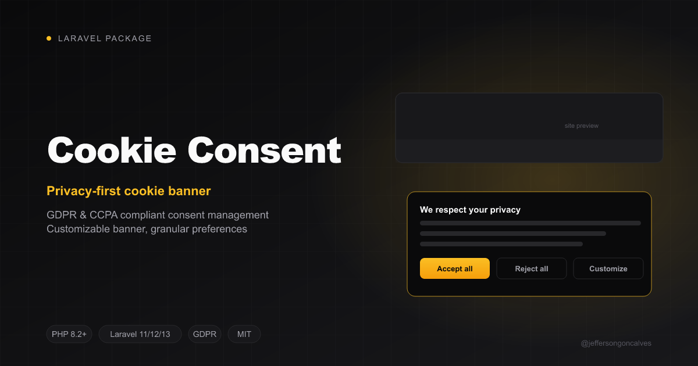
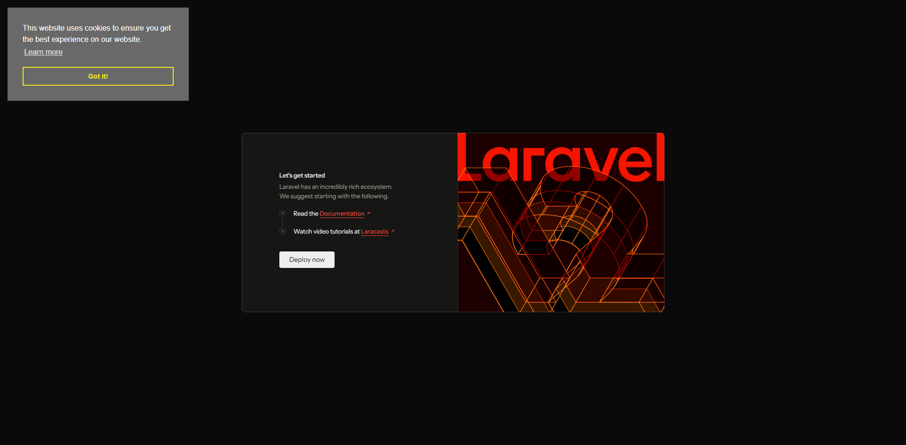
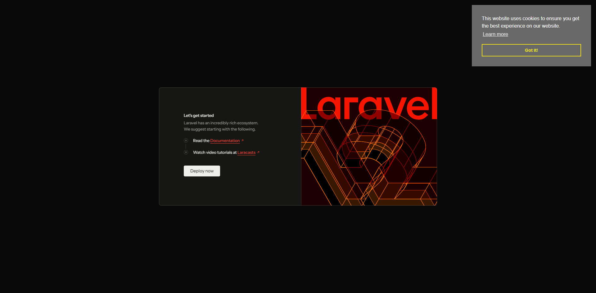
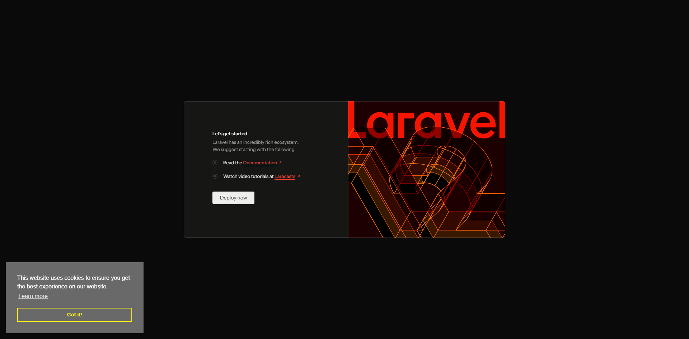
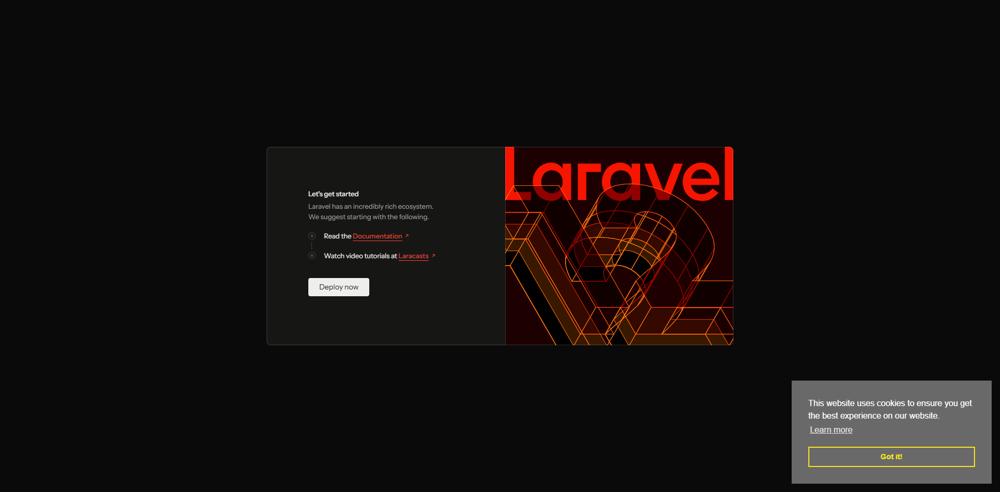

<div class="filament-hidden">



</div>

# Laravel Cookie Consent

[](https://buymeacoffee.com/jeffersongoncalves)

[](https://packagist.org/packages/jeffersongoncalves/laravel-cookie-consent)
[](https://github.com/jeffersongoncalves/laravel-cookie-consent/actions?query=workflow%3A"Fix+PHP+code+styling"+branch%3Amain)
[](https://packagist.org/packages/jeffersongoncalves/laravel-cookie-consent)

This Laravel package provides a simple and elegant way to implement cookie consent on your website, ensuring compliance with privacy regulations like GDPR and CCPA. It offers a clean and customizable interface, allowing you to easily manage and display cookie consent banners and preferences.

## Installation

You can install the package via composer:

```bash
composer require jeffersongoncalves/laravel-cookie-consent
```

Run the migrations to create the settings in the database:

```bash
php artisan migrate
```

## Usage

Add head template.

```php
@include('cookie-consent::cookie-consent-head')
```

Add body template.

```php
@include('cookie-consent::cookie-consent-body')
```

Publish views (optional).

```bash
php artisan vendor:publish --tag=cookie-consent-views
```

Publish settings migrations (optional).

```bash
php artisan vendor:publish --tag=cookie-consent-settings-migrations
```

## Configuration

All settings are stored in the database using [spatie/laravel-settings](https://github.com/spatie/laravel-settings). You can access and modify them at runtime using the `CookieConsentSettings` class or the `cookie_consent_settings()` helper.

### Accessing settings

```php
use JeffersonGoncalves\CookieConsent\Settings\CookieConsentSettings;

// Via helper
$settings = cookie_consent_settings();

// Via container
$settings = app(CookieConsentSettings::class);

// Read a value
$position = $settings->position;
```

### Updating settings

```php
$settings = cookie_consent_settings();
$settings->position = 'top-right';
$settings->popup_background = '#000000';
$settings->save();
```

### Available settings

| Property | Type | Default |
|----------|------|---------|
| `css_url` | `string` | `https://cdn.jsdelivr.net/npm/cookieconsent@3/build/cookieconsent.min.css` |
| `js_url` | `string` | `https://cdn.jsdelivr.net/npm/cookieconsent@3/build/cookieconsent.min.js` |
| `content_header` | `?string` | `null` (translated) |
| `content_message` | `?string` | `null` (translated) |
| `content_dismiss` | `?string` | `null` (translated) |
| `content_allow` | `?string` | `null` (translated) |
| `content_deny` | `?string` | `null` (translated) |
| `content_link` | `?string` | `null` (translated) |
| `content_href` | `?string` | `null` (hides the "learn more" link) |
| `content_close` | `string` | `&#x274c;` |
| `content_target` | `string` | `_blank` |
| `content_policy` | `?string` | `null` (translated) |
| `popup_background` | `string` | `#696969` |
| `popup_text` | `string` | `#FFFFFF` |
| `popup_link` | `string` | `#FFFFFF` |
| `button_background` | `string` | `transparent` |
| `button_border` | `string` | `#f8e71c` |
| `button_text` | `string` | `#f8e71c` |
| `highlight_background` | `string` | `#f8e71c` |
| `highlight_border` | `string` | `#f8e71c` |
| `highlight_text` | `string` | `#000000` |
| `position` | `string` | `bottom-left` |
| `theme` | `string` | `block` |
| `type` | `string` | `info` (`info`, `opt-in` or `opt-out`) |
| `consent_mode` | `bool` | `false` |

### Translations

The banner text is translated into the app locale. A `content_*` text setting left at `null` renders `__('cookie-consent::banner.<key>')`; a string value overrides it in every locale.

Shipped locales: `ar az cs de en es fa fr he hi id it ja nl pl pt pt_BR pt_PT ru sk tr uk uz zh_CN`.

Override or add a locale by publishing the files:

```bash
php artisan vendor:publish --tag=cookie-consent-translations
```

Upgrading: the `make_cookie_consent_content_translatable` settings migration sets the text settings that still hold the old English defaults to `null`. Text you customised is kept.

### Position

| Top Left | Top Right |
| :---: | :---: |
|  |  |
| **Bottom Left** | **Bottom Right** |
|  |  |

## Google Consent Mode v2

Google requires [Consent Mode v2](https://developers.google.com/tag-platform/security/guides/consent) for ads and analytics measurement of EEA/UK visitors. Turn it on and pick a compliance type:

```php
$settings = cookie_consent_settings();
$settings->type = 'opt-in';      // banner shows Allow / Decline
$settings->consent_mode = true;
$settings->save();
```

The head view then pushes `gtag('consent', 'default', ...)` for `ad_storage`, `ad_user_data`, `ad_personalization` and `analytics_storage`, restoring a previous choice from the `cookieconsent_status` cookie, and the banner pushes `gtag('consent', 'update', ...)` when the visitor chooses.

| `type` | Before a choice | Allow | Decline |
|---|---|---|---|
| `opt-in` | denied | granted | denied |
| `opt-out` | granted | granted | denied |
| `info` | granted | — | — |

Include the head view **before** the Google Tag Manager or gtag snippet, so their tags start with the consent state already set:

```blade
<head>
    @include('cookie-consent::cookie-consent-head')
    @include('gtm::head') {{-- or @include('gtag::script') --}}
</head>
```

Works with [laravel-gtm](https://github.com/jeffersongoncalves/laravel-gtm) and [laravel-gtag](https://github.com/jeffersongoncalves/laravel-gtag), or any Google tag on the page. `type` defaults to `info` and `consent_mode` to `false`, so upgrading changes nothing until you opt in; run `php artisan migrate` after updating to add the two settings.

## Content Security Policy

When your app sets a CSP nonce through Laravel's Vite (`Vite::useCspNonce()`, as [laravel-security-headers](https://github.com/jeffersongoncalves/laravel-security-headers) does), every `<script>` this package renders carries it, so a `script-src 'self' 'nonce-{nonce}'` policy works without `'unsafe-inline'`. Scripts loaded afterwards from the vendor's own CDN still need that host in `script-src` (and its API in `connect-src`).

## Testing

```bash
composer test
```

## Changelog

Please see [CHANGELOG](CHANGELOG.md) for more information on what has changed recently.

## Contributing

Please see [CONTRIBUTING](.github/CONTRIBUTING.md) for details.

## Security Vulnerabilities

Please review [our security policy](../../security/policy) on how to report security vulnerabilities.

## Credits

This package uses the [Osano CookieConsent](https://github.com/osano/cookieconsent) plugin.

- [Jèfferson Gonçalves](https://github.com/jeffersongoncalves)
- [All Contributors](../../contributors)

## License

The MIT License (MIT). Please see [License File](LICENSE.md) for more information.
